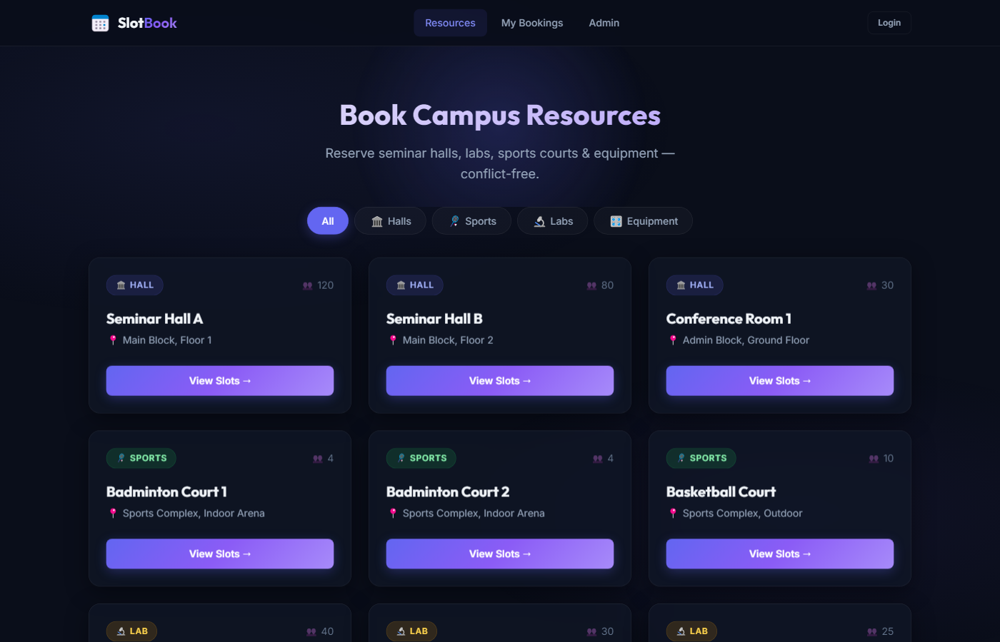
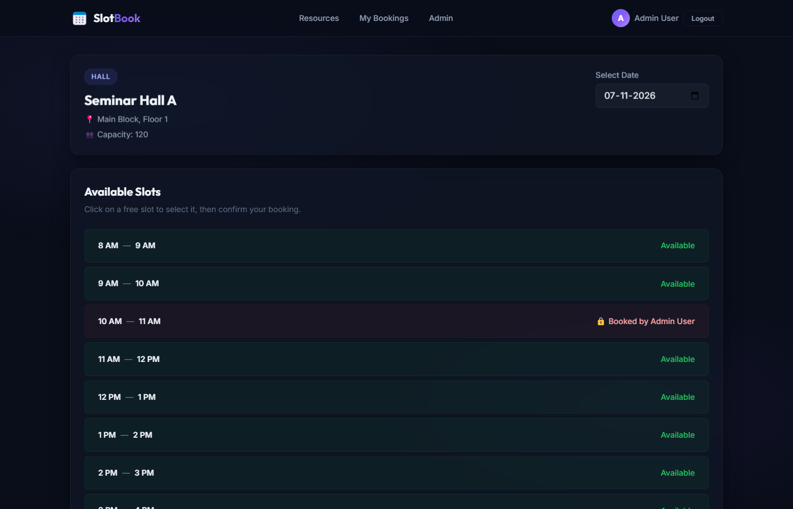
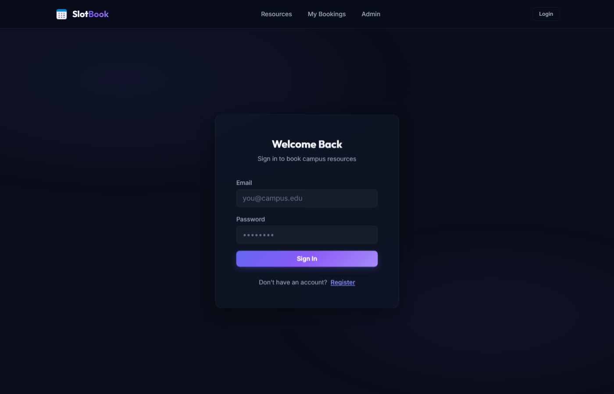
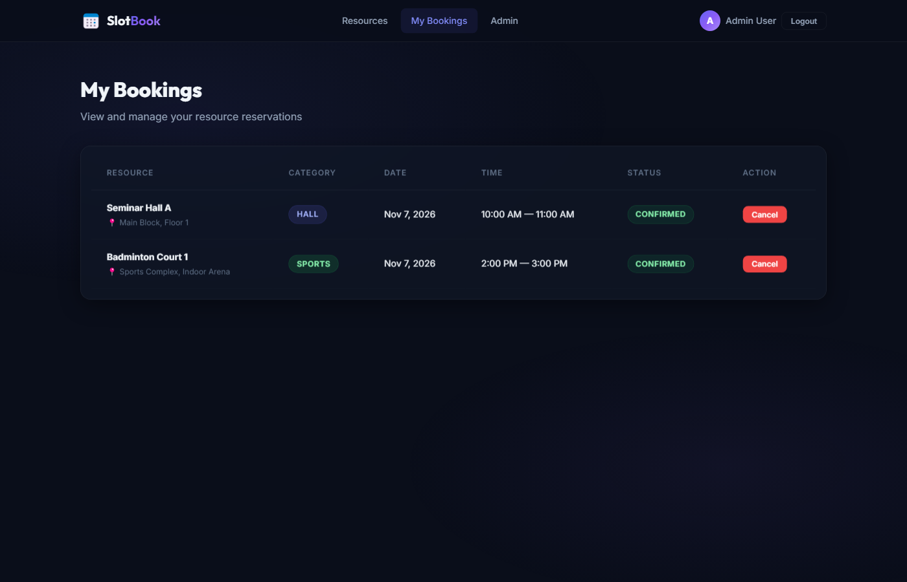
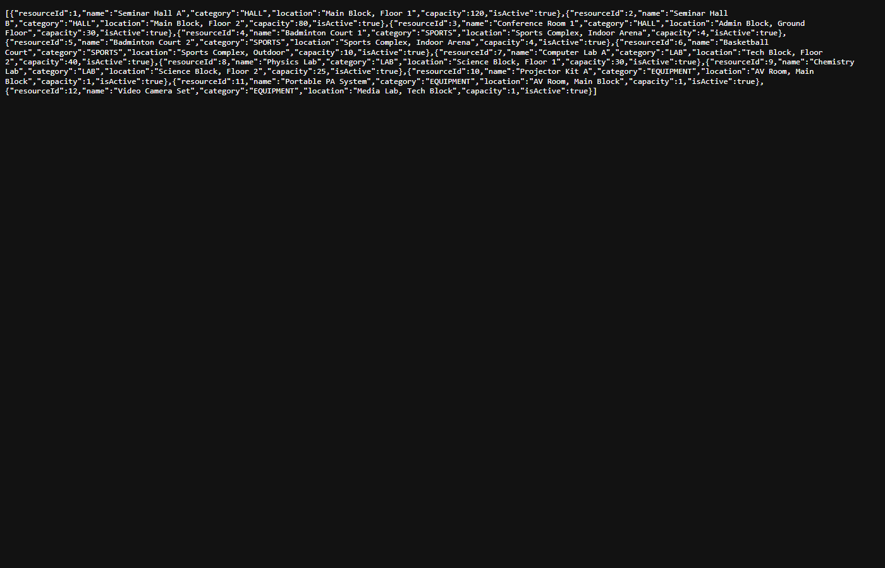
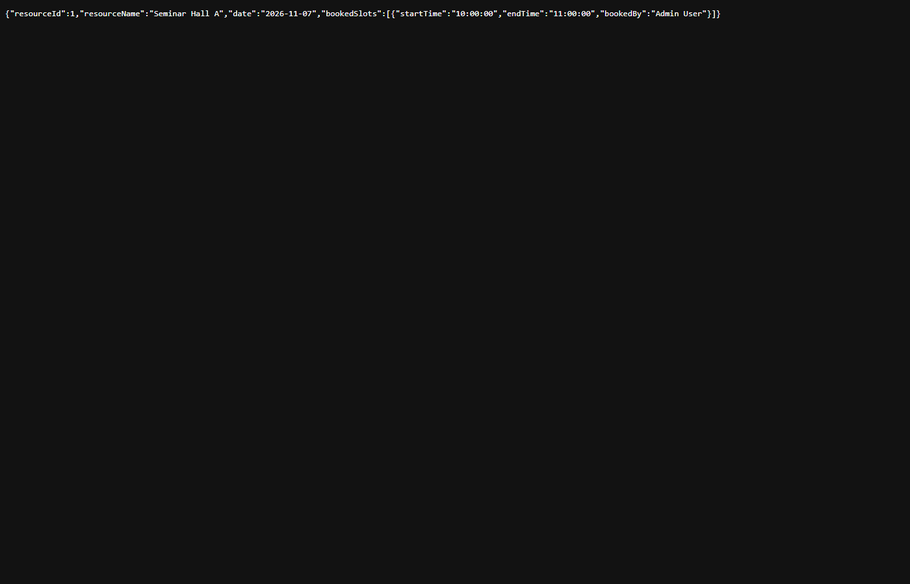
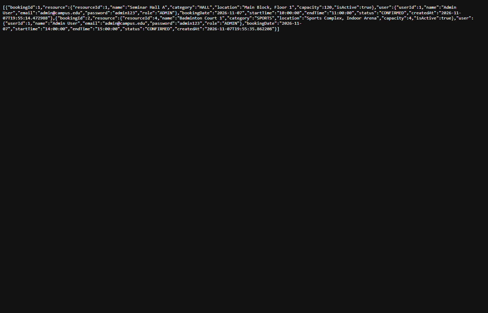

# 📅 SlotBook — Campus Resource Booking System

> A full-stack web application for booking campus resources — seminar halls, labs, sports courts, and equipment — with real-time conflict detection.

---

## 🚀 How to Run (Quick Start)

### Option 1 — One Click ✅ (Recommended)
Double-click **`START.bat`** in the project root. It will:
1. Start the Spring Boot backend automatically (on port 8080)
2. Start the lightweight frontend server (on port 3000)
3. Wait for the backend to be healthy and open `http://localhost:3000` in your browser

To stop all running services cleanly at any time, double-click **`STOP.bat`**.

---

### Option 2 — Manual

**Step 1 — Start the backend:**
```bash
cd slotbook/backend
mvn spring-boot:run
```
Wait until you see: `Started SlotbookApplication in X seconds`

**Step 2 — Start the frontend server:**  
```bash
cd slotbook/frontend
node server.js 3000
```
Then open `http://localhost:3000` in any browser (or open `slotbook/frontend/index.html` directly).

---

## 🔑 Login Credentials

| Role    | Email                  | Password      | Notes |
|---------|------------------------|---------------|-------|
| Admin   | `admin@campus.edu`     | `admin123`    | Pre-seeded demo admin |
| Student | `rahul@campus.edu`     | `password123` | Pre-seeded demo student |
| New     | Register on page       | Custom        | Self-service registration |

---

## 🌐 URLs

| Service      | URL                                      |
|--------------|------------------------------------------|
| Frontend     | `http://localhost:3000`                  |
| Backend API  | `http://localhost:8080/api`              |
| H2 Database  | `http://localhost:8080/h2-console`       |

**H2 Console Settings:**
- JDBC URL: `jdbc:h2:mem:slotbookdb`
- Username: `sa`
- Password: *(leave blank)*

---

## 📸 Screenshots

### Frontend
| Resources / Home Page | Slot Booking Timeline |
|:---:|:---:|
|  |  |

| User Login & Registration | My Bookings |
|:---:|:---:|
|  |  |

### Backend & API
| Resources REST API | Slot Availability REST API |
|:---:|:---:|
|  |  |

| User Bookings REST API | H2 Database Console |
|:---:|:---:|
|  |  |

---

## 📦 Pre-loaded Resources (12 total)

| Category  | Resources |
|-----------|-----------|
| 🏛️ Hall    | Seminar Hall A (120), Seminar Hall B (80), Conference Room 1 (30) |
| 🏸 Sports  | Badminton Court 1 & 2 (4 each), Basketball Court (10) |
| 🔬 Lab     | Computer Lab A (40), Physics Lab (30), Chemistry Lab (25) |
| 🎛️ Equipment | Projector Kit A, Portable PA System, Video Camera Set |

---

## 🗂️ Project Structure

```
SlotBook/
├── START.bat                          ← Double-click to launch backend & frontend
├── STOP.bat                           ← Double-click to stop all services
├── screenshots/                       ← UI & API screenshots
├── slotbook/
│   ├── backend/                       ← Spring Boot (Java 23, Maven)
│   │   ├── pom.xml
│   │   └── src/main/
│   │       ├── java/com/slotbook/
│   │       │   ├── SlotbookApplication.java
│   │       │   ├── controller/        ← REST API endpoints
│   │       │   │   ├── UserController.java
│   │       │   │   ├── ResourceController.java
│   │       │   │   └── BookingController.java
│   │       │   ├── service/           ← Business logic
│   │       │   │   ├── UserService.java
│   │       │   │   ├── ResourceService.java
│   │       │   │   └── BookingService.java
│   │       │   ├── entity/            ← JPA entities (DB tables)
│   │       │   │   ├── User.java
│   │       │   │   ├── Resource.java
│   │       │   │   └── Booking.java
│   │       │   ├── repository/        ← Spring Data JPA
│   │       │   │   ├── UserRepository.java
│   │       │   │   ├── ResourceRepository.java
│   │       │   │   └── BookingRepository.java
│   │       │   ├── dto/               ← Request/Response DTOs
│   │       │   │   ├── BookingRequestDTO.java
│   │       │   │   └── AvailabilityResponseDTO.java
│   │       │   └── config/
│   │       │       ├── WebConfig.java             ← CORS config
│   │       │       └── GlobalExceptionHandler.java
│   │       └── resources/
│   │           ├── application.properties         ← H2 DB config
│   │           ├── schema.sql                     ← Table definitions
│   │           └── data.sql                       ← Seed data (12 resources)
│   └── frontend/                      ← Vanilla HTML/CSS/JS
│       ├── index.html                 ← Resource listing page
│       ├── login.html                 ← Login / Register page
│       ├── booking.html               ← Time slot booking page
│       ├── my-bookings.html           ← View & cancel bookings
│       ├── admin.html                 ← Admin: add resources
│       ├── css/style.css              ← All styles (dark theme)
│       └── js/
│           ├── api.js                 ← All fetch() API calls + auth helpers
│           ├── resources.js           ← Resource card grid logic
│           ├── booking.js             ← Timeline & booking confirmation
│           └── mybookings.js          ← Bookings table & cancellation
```

---

## 🔌 REST API Endpoints

### Users
| Method | Endpoint              | Description         |
|--------|-----------------------|---------------------|
| POST   | `/api/users/register` | Register new user   |
| POST   | `/api/users/login`    | Login with email+pw |

### Resources
| Method | Endpoint                            | Description                         |
|--------|-------------------------------------|-------------------------------------|
| GET    | `/api/resources`                    | List all active resources           |
| GET    | `/api/resources?category=HALL`      | Filter by category                  |
| GET    | `/api/resources/{id}/availability?date=YYYY-MM-DD` | Get booked slots for a date |
| POST   | `/api/resources`                    | Add new resource (Admin)            |

### Bookings
| Method | Endpoint                       | Description               |
|--------|--------------------------------|---------------------------|
| POST   | `/api/bookings`                | Create booking (conflict-checked) |
| GET    | `/api/bookings/user/{userId}`  | Get user's bookings       |
| DELETE | `/api/bookings/{id}`           | Cancel a booking          |

---

## 🛠️ Tech Stack

| Layer     | Technology                              |
|-----------|-----------------------------------------|
| Frontend  | HTML5, Vanilla CSS (dark glassmorphism), Vanilla JS |
| Backend   | Java 23, Spring Boot 3.4, Spring Data JPA |
| Database  | H2 In-Memory (auto-reset on restart)   |
| Build     | Apache Maven 3.9                        |

---

## ✅ Features

- **Register & Login** — session stored in `localStorage`
- **Browse Resources** — filter by category (Hall / Sports / Lab / Equipment)
- **Hourly Timeline** — 8 AM to 9 PM, greyed-out booked slots
- **Conflict Detection** — backend rejects overlapping bookings
- **My Bookings** — view all past and upcoming bookings
- **Cancel Booking** — marks status as CANCELLED
- **Admin Panel** — add new resources to the system
- **Toast Notifications** — success/error feedback throughout

---

*Built with Spring Boot + Vanilla JS — SlotBook Campus Resource Booking System*
